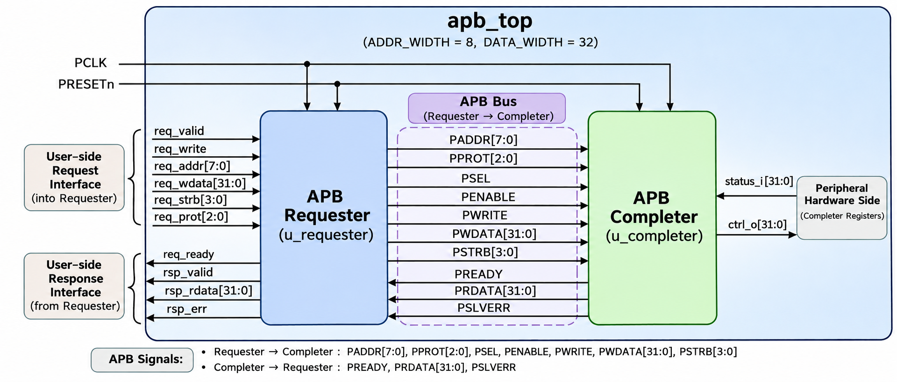
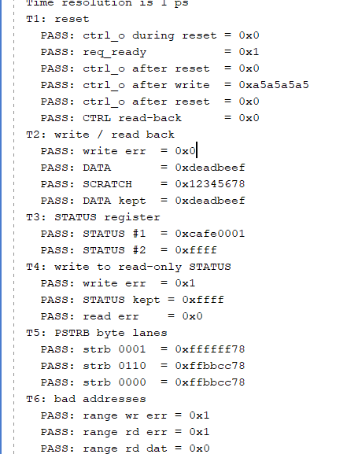
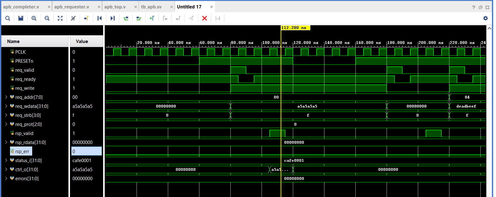
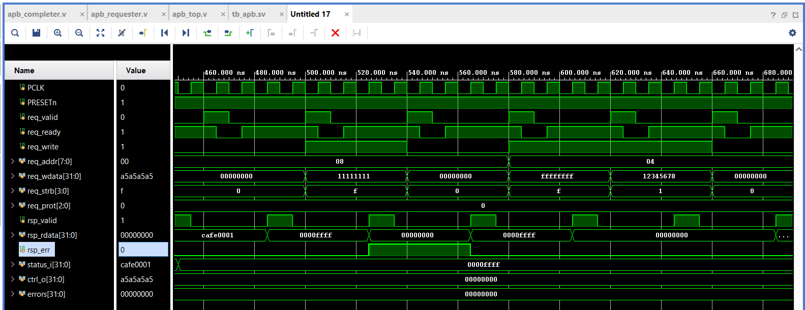
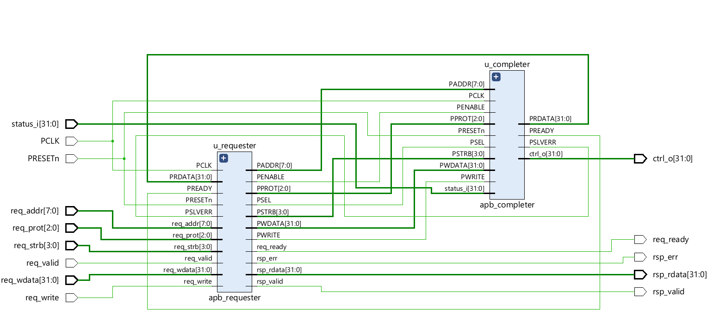

# AMBA APB Requester and Completer (Verilog RTL + SystemVerilog Verification)

A small, readable implementation of the **AMBA APB4** protocol: a synthesizable **Requester** (bridge side), a parameterized **Completer** (peripheral side with a register block), a top level that connects them, and a self-checking **SystemVerilog testbench** with **protocol assertions**.

The project was built as a learning path for AMBA protocols, following the *AMBA APB Protocol Specification (ARM IHI 0024E)*. Every design decision that the spec leaves open is documented below.



---

## Features

- **APB Requester** (`apb_requester.v`): IDLE / SETUP / ACCESS FSM, simple request/response interface, back-to-back transfers (ACCESS → SETUP with no idle cycle), `PSTRB` forced to zero on reads
- **APB Completer** (`apb_completer.v`): 4-register block, configurable wait states, `PSTRB` byte-lane writes, `PSLVERR` error responses
- **Parameterized**: `ADDR_WIDTH`, `DATA_WIDTH` (8/16/32) and `WAIT_STATES`
- **Self-checking testbench** with a reference model and scoreboard: 11 test groups, directed plus constrained-random
- **SVA protocol checker** (`apb_checker.sv`): assertions checked on every clock cycle
- **Beginner-friendly testbench** (`tb_apb_simple.sv`): 6 directed tests plus the 5 most important assertions
- Runs on **Icarus Verilog**, **Verilator** and the **Vivado simulator**

---

## Repository structure

```
.
├── rtl/
│   ├── apb_requester.v      # APB Requester FSM (synthesizable)
│   ├── apb_completer.v      # APB Completer with register block
│   └── apb_top.v            # Connects Requester and Completer
├── tb/
│   ├── tb_apb.sv            # Full testbench: 11 tests, scoreboard, random
│   ├── tb_apb_simple.sv     # Beginner testbench: 6 tests + 5 assertions
│   └── apb_checker.sv       # SVA protocol checker (used by tb_apb.sv)
├── docs/images/             # Diagrams, waveforms, logs used in this README
├── Makefile                 # Run targets for Icarus and Verilator
└── README.md
```

---

## How it works

### The transfer

Every APB transfer has two phases, and the Completer decides when it ends with `PREADY`:

| Phase | PSEL | PENABLE | What happens |
|---|---|---|---|
| IDLE | 0 | 0 | Bus idle |
| SETUP | 1 | 0 | Address, direction and data are presented (exactly 1 cycle) |
| ACCESS | 1 | 1 | Stays here while `PREADY` = 0 (wait states). The transfer ends when `PSEL & PENABLE & PREADY`. |

After the last ACCESS cycle the Requester goes to IDLE, or straight to SETUP if another request is waiting.

### Requester (`apb_requester.v`)

Converts a simple user-side interface into APB transfers.

| Signal | Direction | Meaning |
|---|---|---|
| `req_valid` / `req_ready` | in / out | Request handshake. Accepted when both are HIGH. |
| `req_write`, `req_addr`, `req_wdata`, `req_strb`, `req_prot` | in | The transfer to perform |
| `rsp_valid` | out | One-cycle pulse when the transfer completes |
| `rsp_rdata`, `rsp_err` | out | Read data and `PSLVERR` captured at completion |

Design notes:
- The request is **latched on acceptance**, so `PADDR`, `PWRITE`, `PWDATA`, `PSTRB` and `PPROT` stay stable for the whole transfer (required while `PREADY` is LOW).
- `req_ready` is HIGH in IDLE and in the completing ACCESS cycle, which enables back-to-back transfers.

### Completer (`apb_completer.v`)

Has no state machine. It reacts to `PSEL` and `PENABLE`, and a transfer completes when `PSEL & PENABLE & PREADY`.

**Register map** (32-bit data bus, byte offsets):

| Offset | Name | Access | Description |
|---|---|---|---|
| `0x00` | CTRL | RW | Drives the `ctrl_o` output, reset value 0 |
| `0x04` | DATA | RW | Reset value 0 |
| `0x08` | STATUS | RO | Reads the `status_i` input |
| `0x0C` | SCRATCH | RW | Reset value 0 |

**Design decisions** (the spec leaves these to the implementer):

| Topic | Choice |
|---|---|
| Unaligned `PADDR` | `PSLVERR`, no update, read data 0 |
| Address outside the map | `PSLVERR`, no update, read data 0 |
| Write to read-only register | `PSLVERR`, register unchanged |
| Errored write | Register is **not** updated |
| `PSTRB` | Byte-lane writes supported |
| `PPROT` | Accepted but ignored |
| Reset | Asynchronous assert, active-LOW `PRESETn` |
| Wait states | Fixed number from the `WAIT_STATES` parameter |
| `PRDATA` | Driven only during a read ACCESS cycle, zero otherwise |

### Latency

A write accepted at clock edge E0 is committed to the register at edge **E2 + `WAIT_STATES`**, and `rsp_valid` pulses in the following cycle. Consecutive requests then take 2 + `WAIT_STATES` cycles each, because of back-to-back operation.

---

## Quick start

Requirements: [Icarus Verilog](https://steveicarus.github.io/iverilog/) 12 or later and/or [Verilator](https://verilator.org/) 5.x.

```bash
git clone https://github.com/<your-username>/apb-requester-completer.git
cd apb-requester-completer

make verilator            # full testbench + assertions, WAIT_STATES = 0
make verilator WS=2       # same, with 2 wait states
make all                  # regression: 0, 1 and 3 wait states
make iverilog WS=1        # Icarus, no assertions (it does not support SVA)
make verilator-simple     # beginner testbench with 5 assertions
```

Expected result:

```
WAIT_STATES=0 : 87 checks, 393 transfers, 179 back-to-back
ALL TESTS PASSED
```

Without `make`:

```bash
iverilog -g2012 -DNO_SVA -o sim rtl/apb_completer.v rtl/apb_requester.v rtl/apb_top.v tb/tb_apb.sv
vvp sim
```

**Vivado:** add the files in `rtl/` as design sources and `tb/tb_apb.sv` (or `tb_apb_simple.sv`) as a simulation source, set `tb_apb` as the top, and run behavioral simulation.

---

## Verification

### Test cases (`tb/tb_apb.sv`)

| Test | What it checks |
|---|---|
| T1 Reset | Reset values, and a written value is cleared by an asynchronous reset |
| T2 Write / read back | Each RW register stores data and does not disturb others |
| T3 STATUS | Read-only register follows `status_i` |
| T4 Write to read-only | `PSLVERR` is returned and STATUS is unchanged |
| T5 PSTRB | Single, multiple, non-adjacent and empty byte-lane strobes |
| T6 Bad addresses | 12 out-of-range and unaligned addresses give an error, read data 0, and no state change |
| T7 PPROT | All 8 values accepted and ignored |
| T8 Back-to-back | Six requests without waiting, responses in order, ACCESS → SETUP transitions counted |
| T9 Idle gaps | Random spacing between requests |
| T10 Mid-transfer reset | Reset during SETUP and during ACCESS aborts the write and returns the bus to idle |
| T11 Random | 300 random transactions compared against a reference model |

Every request goes through one `send` task that predicts the result; a monitor compares each real response with the prediction. The suite runs unchanged with any `WAIT_STATES` value.

### Assertions (`tb/apb_checker.sv`)

Checked on every clock cycle and disabled during reset:

| Rule | Assertion |
|---|---|
| 1 | `PENABLE` is only HIGH while `PSEL` is HIGH |
| 2 | SETUP is always followed by ACCESS |
| 3 | `PADDR`, `PWRITE`, `PWDATA`, `PSTRB`, `PPROT` stay stable while `PREADY` is LOW |
| 4 | `PENABLE` drops after a completed transfer |
| 5 | `PSTRB` is all zero on reads |
| 6 | `PSLVERR` only in the completion cycle |
| 7 | No X/Z on control signals, and none on payload when it must be valid |
| 8 | Exactly `WAIT_STATES` wait cycles per transfer (specific to this Completer) |

The beginner testbench contains the five most important ones (rules 1, 2, 3, 5, 6) inline.

### Results

- **Icarus Verilog 12** (no assertions): passes with `WAIT_STATES` = 0, 1, 3
- **Verilator 5.020** (with assertions): passes with `WAIT_STATES` = 0, 1, 3
- **Vivado simulator**: simple testbench, screenshots below
- **Bug injection**: the design was deliberately broken in several ways (for example `PWDATA` changing during a wait state, `PSTRB` stuck at `1111`, `PSLVERR` not gated by completion, `PENABLE` without `PSEL`). Each bug was caught by the corresponding assertion or check.

Note: the simple testbench sends one request at a time, so it cannot trigger every assertion path. Use `tb_apb.sv` (back-to-back and random tests) for full coverage of the protocol rules.

### Simulation log



### Waveforms

**Reset test (T1).** CTRL is written with `0xA5A5A5A5`, then cleared to 0 by an asynchronous reset. A write of `0xDEADBEEF` to DATA (`0x04`) follows.



**STATUS, error response and PSTRB (T3 to T5).** Reads of the read-only STATUS register return `0xCAFE0001` and then `0x0000FFFF`. The write to STATUS raises `rsp_err`. Then DATA (`0x04`) is written with `0xFFFFFFFF` and a partial write `0x12345678` with `req_strb = 0001`.



### Elaborated design (Vivado)



---

## Limitations and roadmap

Current limitations:
- One Completer only (single `PSEL`)
- No timeout in the Requester: a Completer that never raises `PREADY` blocks it
- APB4 only: no `PWAKEUP`, user signals, parity check signals or RME (`PNSE`)
- Verilator stops the simulation at the first failed assertion
- Icarus Verilog cannot run the SVA checker (use `-DNO_SVA`)

Planned:
- [ ] Multi-peripheral support: address decoder, `PSELx`, response mux, default error Completer
- [ ] AXI4-Lite to APB bridge in front of the Requester
- [ ] Timeout and hang protection
- [ ] Functional coverage
- [ ] APB5 features (`PWAKEUP`, parity protection)

---

## Spec reference and disclaimer

- *AMBA APB Protocol Specification*, ARM IHI 0024E. The specification itself is not included in this repository; get it from [Arm Developer](https://developer.arm.com/documentation).
- This is an independent educational implementation. It is not provided, endorsed or certified by Arm. AMBA and Arm are trademarks of Arm Limited.

## License

Add a license file of your choice (for example MIT) before publishing.
